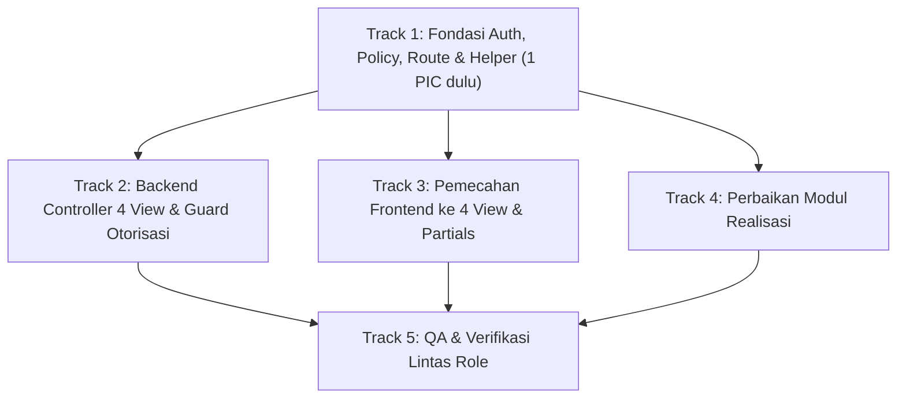

# Tasks & Temuan Audit Teknis — E-RTLH Kota Kediri

Dokumen ini berisi hasil audit teknis codebase **E-RTLH Kota Kediri**, temuan fungsional, rekomendasi arsitektur, serta pembagian task tim yang dirancang agar **pengerjaan antar developer berjalan paralel tanpa saling menimpa (*merge conflict*)**.

> **Status Dokumen:** Hasil audit codebase (tanpa perubahan kode).
> **Cakupan Role:** `superadmin`, `admin_dinas`, `admin_kelurahan`.

---

## Bagian 1: Katalog Temuan & Rekomendasi Lengkap

### F-01 — Bug Filter & Badge Status `Diverifikasi` (`1`) Tidak Muncul di Tabel
* **Prioritas:** Tinggi (Bug UI/Fungsional)
* **Bukti Kode:**
  * [`resources/views/pages/warga/viewwarga.blade.php` L282–L289](file:///d:/RESHA/Kerja/Projects/E_RTLH-Laravel/resources/views/pages/warga/viewwarga.blade.php#L282-L289) — Dropdown filter memiliki opsi `1 = Diverifikasi Lapangan`.
  * [`resources/views/pages/warga/viewwarga.blade.php` L544–L553](file:///d:/RESHA/Kerja/Projects/E_RTLH-Laravel/resources/views/pages/warga/viewwarga.blade.php#L544-L553) & [L691–L700](file:///d:/RESHA/Kerja/Projects/E_RTLH-Laravel/resources/views/pages/warga/viewwarga.blade.php#L691-L700) — Kondisi `@if/@elseif` hanya mengecek `STATUS_DISETUJUI (2)`, `STATUS_REVISI (3)`, dan `STATUS_DITOLAK (4)`.
  * [`resources/views/pages/warga/viewwarga.blade.php` L267–L344](file:///d:/RESHA/Kerja/Projects/E_RTLH-Laravel/resources/views/pages/warga/viewwarga.blade.php#L267-L344) — Dropdown `status_bantuan` berada di dalam `@if($isDinas)`, sehingga `admin_kelurahan` tidak memiliki filter status.
* **Dampak:** Ketika user memilih filter status `Diverifikasi Lapangan (1)`, data tetap terfilter oleh backend (`WargaController::buildWargaQuery()`), tetapi di tabel tampil dengan badge **"Menunggu Verifikasi"** / **"Menunggu"**, sehingga terkesan status `Diverifikasi` tidak pernah muncul atau tidak bekerja. Hal yang sama terjadi pada status `5` (`Direalisasikan`).
* **Rekomendasi:**
  1. Tambahkan cabang `@elseif` eksplisit untuk `Bantuan::STATUS_DIVERIFIKASI (1)` (`Diverifikasi Lapangan`) dan `Bantuan::STATUS_DIREALISASIKAN (5)` (`Direalisasikan`) di seluruh badge status (atau buat helper/accessor `status_label` & `status_badge_class` pada model `Bantuan` agar konsisten di semua view dan ekspor).
  2. Sediakan filter status yang sesuai di setiap view baru untuk semua role yang berkepentingan.

---

### F-02 — Penumpukan Alur dalam 1 View & Tombol Aksi Tercampur (+ Risiko Null Pointer di Tab 2)
* **Prioritas:** Tinggi (Arsitektur UI & Bug Potensial)
* **Bukti Kode:**
  * [`resources/views/pages/warga/viewwarga.blade.php` L380–L405](file:///d:/RESHA/Kerja/Projects/E_RTLH-Laravel/resources/views/pages/warga/viewwarga.blade.php#L380-L405) — Satu view menampung 4 tab berbeda untuk seluruh status.
  * [`resources/views/pages/warga/viewwarga.blade.php` L563–L583](file:///d:/RESHA/Kerja/Projects/E_RTLH-Laravel/resources/views/pages/warga/viewwarga.blade.php#L563-L583) — Tombol *Verifikasi Dinas*, *Detail*, *Edit*, dan *Hapus* menumpuk dalam satu `btn-group` tanpa mempertimbangkan status bantuan maupun role.
  * [`resources/views/pages/warga/viewwarga.blade.php` L715](file:///d:/RESHA/Kerja/Projects/E_RTLH-Laravel/resources/views/pages/warga/viewwarga.blade.php#L715) — Tombol Verifikasi di Tab 2 memanggil `$bantuan->id_bantuan` **tanpa guard `@if($bantuan)`**.
* **Dampak:** User bingung membedakan data yang masih tahap usulan, verifikasi dinas, atau sudah disetujui; tombol edit/hapus muncul di baris yang seharusnya sudah terkunci; dan jika ada warga tanpa record `bantuan` (`$bantuan === null`), Tab 2 akan melempar error PHP `Attempt to read property "id_bantuan" on null`.
* **Rekomendasi:**
  1. Pecah UI menjadi **4 view/halaman terpisah** sesuai alur bisnis (lihat Bagian 2).
  2. Pisahkan tombol aksi per halaman berdasarkan role dan status, serta selalu pasang guard `@if($bantuan)` sebelum mengakses relasi bantuan.

---

### F-03 — Celah Otorisasi Status & Wilayah di `WargaController`, `HunianController`, dan `RumahController`
* **Prioritas:** Kritis (Keamanan & Integritas Data)
* **Bukti Kode:**
  * [`app/Http/Controllers/WargaController.php` L399–L720](file:///d:/RESHA/Kerja/Projects/E_RTLH-Laravel/app/Http/Controllers/WargaController.php#L399-L720) — Pembatasan `visibleTo(Auth::user())` hanya ada di `buildWargaQuery()` (`index` & `exportExcel`). Method `show()`, `edit()`, `update()`, dan `destroy()` langsung memanggil `findOrFail($id)` tanpa cek wilayah maupun status.
  * [`app/Policies/Wargapolicy.php`](file:///d:/RESHA/Kerja/Projects/E_RTLH-Laravel/app/Policies/Wargapolicy.php) & [`app/Policies/Bantuanpolicy.php`](file:///d:/RESHA/Kerja/Projects/E_RTLH-Laravel/app/Policies/Bantuanpolicy.php) — Policy sudah dibuat, tetapi **tidak pernah dipanggil** oleh controller atau route mana pun.
  * [`resources/views/pages/warga/create.blade.php` L192](file:///d:/RESHA/Kerja/Projects/E_RTLH-Laravel/resources/views/pages/warga/create.blade.php#L192) & [`edit.blade.php` L184](file:///d:/RESHA/Kerja/Projects/E_RTLH-Laravel/resources/views/pages/warga/edit.blade.php#L184) — Dropdown `id_wilayah` menampilkan semua kelurahan dan tidak dikunci untuk `admin_kelurahan`.
  * [`app/Http/Controllers/HunianController.php` L123–L211](file:///d:/RESHA/Kerja/Projects/E_RTLH-Laravel/app/Http/Controllers/HunianController.php#L123-L211) & [`RumahController.php` L230–L439](file:///d:/RESHA/Kerja/Projects/E_RTLH-Laravel/app/Http/Controllers/RumahController.php#L230-L439) — Kondisi sama: `show`, `edit`, `update`, `destroy` tidak mengecek cakupan `id_wilayah`.
* **Dampak:**
  * `admin_kelurahan` A bisa melihat, mengedit, atau menghapus data warga kelurahan B melalui URL `/warga/{id}` atau `/warga/{id}/edit`.
  * `admin_kelurahan` bisa menginput warga ke kelurahan lain.
  * `admin_kelurahan` tetap bisa mengedit/menghapus data yang sudah berstatus `Disetujui Dinas (2)`, `Ditolak (4)`, atau `Direalisasikan (5)`.
* **Rekomendasi:**
  1. Terapkan pengecekan `WargaPolicy` (atau helper otorisasi di controller) pada `show`, `edit`, `update`, `destroy`:
     * `superadmin`: akses penuh di semua wilayah & semua status.
     * `admin_dinas`: bisa `view` semua wilayah, dan hanya bisa update/verifikasi sesuai wewenang View 2–4 (tidak boleh hapus permanen data master warga kecuali ditetapkan lain).
     * `admin_kelurahan`: hanya wilayahnya sendiri (`id_wilayah === user->id_wilayah`), **boleh edit hanya saat status `0` (Menunggu Verifikasi), `1` (Diverifikasi), atau `3` (Perlu Revisi)**, dan **view-only** pada status `2` (Disetujui Dinas), `4` (Ditolak), serta `5` (Direalisasikan).
  2. Pada `WargaController::store()` dan form `create`/`edit`, paksa `id_wilayah = Auth::user()->id_wilayah` bila user adalah `admin_kelurahan`.

---

### F-04 — Middleware `EnsureUserHasRole` Belum Lengkap (`return $next`) & Belum Dipasang di Route
* **Prioritas:** Tinggi (Keamanan)
* **Bukti Kode:**
  * [`app/Http/Middleware/Ensureuserhasrole.php` L16–L23](file:///d:/RESHA/Kerja/Projects/E_RTLH-Laravel/app/Http/Middleware/Ensureuserhasrole.php#L16-L23) — Setelah pengecekan `if (! $user || ! in_array(...))`, method `handle()` **tidak memiliki `return $next($request);`**.
  * [`bootstrap/app.php` L16–L18](file:///d:/RESHA/Kerja/Projects/E_RTLH-Laravel/bootstrap/app.php#L16-L18) — Alias `'role'` sudah didaftarkan, tetapi [`routes/web.php`](file:///d:/RESHA/Kerja/Projects/E_RTLH-Laravel/routes/web.php) belum menggunakannya.
  * [`app/Providers/AppServiceProvider.php` L26–L37](file:///d:/RESHA/Kerja/Projects/E_RTLH-Laravel/app/Providers/AppServiceProvider.php#L26-L37) — 8 `Gate::define(...)` didefinisikan tetapi belum dipakai.
* **Dampak:** Jika middleware `'role:...'` langsung dipasang di `routes/web.php`, semua request yang lolos role akan crash (`TypeError: Return value must be of type Response, none returned`).
* **Rekomendasi:** Tambahkan `return $next($request);` pada `EnsureUserHasRole::handle()`, lalu terapkan middleware `'role:...'` pada grup route di `routes/web.php` (misalnya `role:superadmin` untuk `program-bantuan.*`, `role:superadmin,admin_dinas` untuk `spk.*` & `realisasi.*`).

---

### F-05 — Penamaan File Middleware & Policy Tidak PascalCase (Risiko Error di Server Linux)
* **Prioritas:** Sedang (Kompatibilitas Deployment)
* **Bukti Kode:**
  * [`app/Http/Middleware/Ensureuserhasrole.php`](file:///d:/RESHA/Kerja/Projects/E_RTLH-Laravel/app/Http/Middleware/Ensureuserhasrole.php) (class `EnsureUserHasRole`)
  * [`app/Policies/Wargapolicy.php`](file:///d:/RESHA/Kerja/Projects/E_RTLH-Laravel/app/Policies/Wargapolicy.php) (class `WargaPolicy`)
  * [`app/Policies/Bantuanpolicy.php`](file:///d:/RESHA/Kerja/Projects/E_RTLH-Laravel/app/Policies/Bantuanpolicy.php) (class `BantuanPolicy`)
* **Dampak:** Di Windows (case-insensitive) berjalan normal, tetapi di server Linux/Docker (case-sensitive) PSR-4 autoloader akan gagal menemukan ketiga class tersebut (`Class not found`).
* **Rekomendasi:** Rename file menggunakan `git mv` menjadi `EnsureUserHasRole.php`, `WargaPolicy.php`, dan `BantuanPolicy.php`.

---

### F-06 — Duplikasi Route `/warga` vs `/Warga` & Redirect Tidak Konsisten
* **Prioritas:** Sedang (Konsistensi Routing)
* **Bukti Kode:**
  * [`routes/web.php` L31–L32](file:///d:/RESHA/Kerja/Projects/E_RTLH-Laravel/routes/web.php#L31-L32) — Ada `Route::resource('warga', WargaController::class)` (membuat `warga.index` -> `/warga`) dan `Route::get('/Warga', ...)->name('warga')`.
  * [`resources/views/layouts/sidebar.blade.php` L36](file:///d:/RESHA/Kerja/Projects/E_RTLH-Laravel/resources/views/layouts/sidebar.blade.php#L36) & [`viewwarga.blade.php` L257](file:///d:/RESHA/Kerja/Projects/E_RTLH-Laravel/resources/views/pages/warga/viewwarga.blade.php#L257) memakai `route('warga')` (`/Warga`), sedangkan `WargaController` melakukan redirect ke `route('warga.index')` (`/warga`).
* **Dampak:** URL berubah-ubah antara `/Warga` dan `/warga`, membingungkan saat menambah route baru untuk pemecahan 4 view.
* **Rekomendasi:** Hapus `/Warga` dan standarkan ke lowercase `/warga` (`route('warga.index')`), atau jadikan `/Warga` hanya redirect 301 ke `/warga` jika masih ada bookmark lama.

---

### F-07 — Inkonsistensi Status di Fitur Realisasi & Bug `RealisasiController::destroy()`
* **Prioritas:** Tinggi (Logika Bisnis & Bug)
* **Bukti Kode:**
  * [`app/Http/Controllers/RealisasiController.php` L47–L51](file:///d:/RESHA/Kerja/Projects/E_RTLH-Laravel/app/Http/Controllers/RealisasiController.php#L47-L51) — Query default menampilkan `STATUS_DISETUJUI (2)`, `STATUS_DIREALISASIKAN (5)`, **dan** `STATUS_DIVERIFIKASI (1)`.
  * [`app/Http/Controllers/RealisasiController.php` L185–L190](file:///d:/RESHA/Kerja/Projects/E_RTLH-Laravel/app/Http/Controllers/RealisasiController.php#L185-L190) & [L220–L222](file:///d:/RESHA/Kerja/Projects/E_RTLH-Laravel/app/Http/Controllers/RealisasiController.php#L220-L222) — Jika progres diturunkan dari 100% atau record realisasi dihapus, status kembali ke `STATUS_DISETUJUI (2)`.
  * [`app/Http/Controllers/RealisasiController.php` L208](file:///d:/RESHA/Kerja/Projects/E_RTLH-Laravel/app/Http/Controllers/RealisasiController.php#L208) — Baris `findOrFail($id_bantuan ?? $id_realisasi)` menggunakan variabel `$id_bantuan` yang tidak pernah didefinisikan.
  * [`resources/views/pages/realisasi/index.blade.php` L179–L245](file:///d:/RESHA/Kerja/Projects/E_RTLH-Laravel/resources/views/pages/realisasi/index.blade.php#L179-L245) — Tidak ada dropdown filter `status_bantuan` di UI meskipun controller mendukungnya (L44).
* **Dampak:** Warga yang baru berstatus `Diverifikasi (1)` (belum disetujui dinas) bisa langsung dicatat realisasinya hingga 100%; dan di `destroy()` terdapat code smell undefined variable.
* **Rekomendasi:**
  1. Keluarkan `STATUS_DIVERIFIKASI (1)` dari `RealisasiController::index()` dan tambahkan guard di `storeOrUpdate()` agar hanya status `2` (`Disetujui Dinas`) dan `5` (`Direalisasikan`) yang boleh diupdate progresnya.
  2. Bersihkan `$id_bantuan ?? $id_realisasi` menjadi `$id_realisasi`.
  3. Tambahkan filter status (`Disetujui / Siap Realisasi` vs `Direalisasikan 100%`) di View 4 bila dibutuhkan.

---

### F-08 — `WargaController::update()` Mengabaikan `id_program` & View `pages.spk.index` Belum Ada
* **Prioritas:** Sedang
* **Bukti Kode:**
  * [`app/Http/Controllers/WargaController.php` L465](file:///d:/RESHA/Kerja/Projects/E_RTLH-Laravel/app/Http/Controllers/WargaController.php#L465) — `id_program` divalidasi pada `update()`, tetapi tidak ada logic create/update ke model `Bantuan`.
  * [`app/Http/Controllers/SpkController.php` L104](file:///d:/RESHA/Kerja/Projects/E_RTLH-Laravel/app/Http/Controllers/SpkController.php#L104) — `GET /spk` memanggil `view('pages.spk.index')` yang filenya tidak ada di `resources/views/pages/`.
* **Dampak:** Mengubah program bantuan lewat form edit warga tidak tersimpan; membuka URL `/spk` langsung menghasilkan error `View [pages.spk.index] not found`.
* **Rekomendasi:** Sinkronkan `id_program` pada `update()` (bila status masih boleh diedit), dan arahkan `/spk` ke View 2 (Verifikasi Dinas & SPK) atau buat view `pages/spk/index.blade.php` yang terintegrasi dengan View 2.

---

### F-09 — [BACKLOG / NON-WAJIB SPRINT INI] Konsep `Drafting` Sebelum `Menunggu Verifikasi` (Butuh Migrasi Skema)
* **Prioritas:** Backlog / Fase Berikutnya *(sesuai arahan: didokumentasikan tanpa kewajiban implementasi di sprint ini)*
* **Kondisi Saat Ini di Codebase:**
  * Belum ada status `Drafting`. Ketika warga ditambahkan via `WargaController::store()`, bila `id_program` dipilih langsung masuk tabel `bantuan` dengan `status_bantuan = 0` (`STATUS_DIAJUKAN` / Menunggu Verifikasi).
  * Di [`database/migrations/2026_08_16_135033_create_wargas_table.php`](file:///d:/RESHA/Kerja/Projects/E_RTLH-Laravel/database/migrations/2026_08_16_135033_create_wargas_table.php): kolom `nik`, `no_kk`, `nama`, `jenis_kelamin`, `id_wilayah`, `kawin` bertipe `NOT NULL`, dan semua kolom tersebut persis merupakan **data KTP/KK** (yang juga cocok dengan aturan `required` di [`create.blade.php`](file:///d:/RESHA/Kerja/Projects/E_RTLH-Laravel/resources/views/pages/warga/create.blade.php)). Sedangkan data survei (`hunian`, `rumah`, `utilitas`, foto) sudah `nullable`.
  * Di [`app/Services/SawRankingService.php` L23–L30](file:///d:/RESHA/Kerja/Projects/E_RTLH-Laravel/app/Services/SawRankingService.php#L23-L30): engine SAW mengambil seluruh `bantuan` aktif (`is_aktif = true`) tanpa memfilter `status_bantuan`.
  * Selain itu, tabel `bantuan` saat ini menampung seluruh siklus status `0..5` (`0=diajukan, 1=diverifikasi, 2=disetujui, 3=direvisi, 4=ditolak, 5=direalisasikan`).
* **Analisis & Rekomendasi Desain untuk Implementasi Mendatang:**
  1. **Skema Status yang Disarankan (Jangan menunda masuk tabel `bantuan` sampai `Disetujui`):**
     * Jika `bantuan` baru diisi saat `Disetujui Dinas (2)`, maka `spk_ranking` (yang berelasi via `id_bantuan`) dan status `0, 1, 3, 4` akan kehilangan tempat penyimpanan dan SPK tidak bisa dijalankan sebelum disetujui.
     * **Rekomendasi terbaik:**
       * **Tahap `Drafting`:** Data warga (minimal field KTP/KK: `nik`, `no_kk`, `nama`, `jenis_kelamin`, `id_wilayah`, `kawin`) disimpan ke tabel `warga` (+ opsional `hunian`/`rumah`/`utilitas`) dengan penanda draft (misal `warga.is_draft = true` atau `warga.status_update = -1` via migrasi baru) dan **belum membuat record di tabel `bantuan`** (atau bila tetap dibuat di `bantuan`, pakai `STATUS_DRAFT = -1` dan kecualikan di query Dinas & `SawRankingService`).
       * **Visibilitas Draft:** Data draft **hanya muncul di daftar Draft/Usulan milik `admin_kelurahan` penginput (`id_wilayah` terkait)** dan **tidak tampil di antrean Verifikasi Dinas maupun perhitungan SPK SAW** sampai kelurahan menekan tombol **"Kirim / Ajukan Usulan"** (`status = 0 / Menunggu Verifikasi`).
       * **Bila ingin simpan lebih minimal lagi (hanya NIK + Nama):** Tambahkan migrasi `alter table warga` untuk membuat `no_kk`, `jenis_kelamin`, `kawin` menjadi `nullable` saat draft, lalu pindahkan validasi wajib lengkap ke aksi **"Ajukan Usulan"**.

---

## Bagian 2: Target Arsitektur 4 View & Matriks Role

### Pembagian 4 View Sesuai Kesepakatan Final

| View | Nama Halaman / Fokus | Filter Status Default (`bantuan.status_bantuan`) | Akses Role & Perilaku |
| :--- | :--- | :--- | :--- |
| **View 1** | **Daftar Usulan** *(Input & Monitoring Usulan Kelurahan)* | **Pra-verifikasi (`0, 3, 4` + belum ada usulan)** *(default di `warga.index`)* | • **`admin_kelurahan`**: Input baru (wilayah terkunci ke kelurahannya), edit data saat status `0`, `1`, `3`. View-only saat `2`, `4`, `5`. • **`admin_dinas` & `superadmin`**: Melihat usulan masuk lintas kelurahan + tombol **Verifikasi Lapangan** (`0/3/4` -> `1=Diverifikasi`, `3=Revisi`, `4=Ditolak`); `superadmin` bisa hapus. |
| **View 2** | **Verifikasi Dinas & SPK SAW** | **`1` (Diverifikasi Lapangan)** *(di `pages/spk/index.blade.php` via `SpkController@index`)* | • **`admin_dinas` & `superadmin`**: Menjalankan *Hitung Ulang SAW* (khusus status `1` & `2`), ubah bobot kriteria, melihat rincian skor `C1`–`C5`, menetapkan keputusan Dinas (`2=Disetujui`, `1=Diverifikasi`, `3=Revisi`, `4=Ditolak`) + catatan wajib. • **`admin_kelurahan`**: **View-Only Keputusan SPK** untuk wilayahnya sendiri (lihat peringkat SAW, rincian skor `C1`–`C5`, status & catatan verifikator; tombol *Hitung Ulang SAW*, *Bobot Kriteria*, dan *Verifikasi Dinas* disembunyikan; boleh edit data usulan hanya saat status `0`, `1`, `3`). |
| **View 3** | **Calon Penerima Disetujui Dinas** | **`2` (Disetujui Dinas)** *(Otomatis keluar dari View 3 & pindah ke View 4 saat status menjadi `5` Direalisasikan)* | • **`admin_dinas` & `superadmin`**: Bisa memperbarui keputusan verifikasi sebelum realisasi selesai. • **`admin_kelurahan`**: **View-Only** (hanya lihat daftar & detail warga di wilayahnya, tombol Edit/Hapus disembunyikan). |
| **View 4** | **Realisasi & Progres Bantuan** | **`2` (Disetujui Dinas)** *(progres 0–50%)* & **`5` (Direalisasikan)** *(progres 100%)* | • **`admin_dinas` & `superadmin`**: Update progres `0% / 25% / 50% / 100%`, upload foto bertahap & kuitansi SPJ. Saat `100%`, status otomatis menjadi `5` (`Direalisasikan`). • **`admin_kelurahan`**: **View-Only** (hanya lihat daftar & progres realisasi warga di wilayahnya; tombol Update/Hapus disembunyikan & endpoint mutasi tetap memblokir `403`). |

> [!NOTE]
> **Klasifikasi Edit `admin_kelurahan` (Sesuai Konfirmasi):**
> * **Boleh Edit Data Usulan:** Status `0` (*Menunggu Verifikasi*), `3` (*Perlu Revisi*), dan `1` (*Diverifikasi*).
> * **View-Only (Terkunci):** Status `2` (*Disetujui Dinas*), `4` (*Ditolak*), dan `5` (*Direalisasikan*).
> * **Akses `superadmin`:** Memiliki seluruh akses `admin_dinas` di View 1–4 + hak hapus data (`delete`) + pengelolaan Master Data (`program-bantuan`).

---

## Bagian 3: Peta Pembagian Kerja Tim (Anti-Conflict Ownership)

Untuk menghindari *merge conflict* di file gemuk seperti `routes/web.php`, `WargaController.php`, dan `viewwarga.blade.php`, pengerjaan dibagi menjadi **5 Track**:

| Track | PIC Disarankan | File yang Dimiliki (Eksklusif) | Aturan Anti-Tabrakan |
| :--- | :--- | :--- | :--- |
| **Track 1 (Fondasi)** | Dev Lead / Backend 1 | `bootstrap/app.php`, `routes/web.php`, `app/Http/Middleware/EnsureUserHasRole.php`, `app/Policies/WargaPolicy.php`, `app/Policies/BantuanPolicy.php`, `app/Models/Bantuan.php` | Dikerjakan **pertama** sebelum Track 2–4 merge, supaya kontrak nama route & method helper sudah final. |
| **Track 2 (Backend Warga & Verifikasi)** | Backend 1 / 2 | `app/Http/Controllers/WargaController.php`, `app/Http/Controllers/SpkController.php`, `app/Http/Controllers/HunianController.php`, `app/Http/Controllers/RumahController.php` | Tidak menyentuh `RealisasiController.php` maupun file Blade di `resources/views/pages/realisasi/`. |
| **Track 3 (Frontend 4 View & Sidebar)** | Frontend / Blade Dev | `resources/views/layouts/sidebar.blade.php`, `resources/views/pages/warga/*` (dipecah ke folder/partial per view) | Pakai `@include('pages.warga.partials....')` untuk modal/table agar tiap halaman tipis dan tidak edit 1 file yang sama. |
| **Track 4 (Modul Realisasi)** | Backend/Fullstack 2 | `app/Http/Controllers/RealisasiController.php`, `resources/views/pages/realisasi/index.blade.php` | Berdiri sendiri sepenuhnya di namespace `Realisasi`, aman dikerjakan paralel dengan Track 2 & 3. |
| **Track 5 (QA & Backlog)** | QA / Semua Tim | `tests/Feature/*` (opsional) & checklist verifikasi | Menguji seluruh transisi status & role setelah Track 2–4 selesai. |

---

## Bagian 4: Daftar Task Detail per Track

### Track 1 — Fondasi Middleware, Policy, Route & Helper Status *(Wajib Selesai Duluan)*
- [x] **T1.1 — Perbaiki & Rename Middleware Role:**
  - Rename `app/Http/Middleware/Ensureuserhasrole.php` -> `EnsureUserHasRole.php` via `git mv`.
  - Tambahkan `return $next($request);` di akhir `handle()`.
- [x] **T1.2 — Rename & Lengkapi Policy:**
  - Rename `app/Policies/Wargapolicy.php` -> `WargaPolicy.php` dan `Bantuanpolicy.php` -> `BantuanPolicy.php`.
  - Perbarui `WargaPolicy::update(User $user, Warga $warga)`:
    - `superadmin`: `true`.
    - `admin_dinas`: sesuaikan izin (misal `true` untuk View 2–3, atau dikelola lewat `BantuanPolicy`).
    - `admin_kelurahan`: `true` **hanya jika** `$user->id_wilayah === $warga->id_wilayah` **dan** status `bantuanAktif` termasuk `[0, 1, 3]` (atau belum punya `bantuanAktif`). Jika status `[2, 4, 5]`, return `false`.
  - Pastikan `WargaPolicy::create()` mengizinkan `admin_kelurahan` dan `superadmin` (serta `admin_dinas` bila masih diperbolehkan input).
  - Pastikan `WargaPolicy::delete()` hanya `superadmin` (atau sesuai kebijakan tim).
- [x] **T1.3 — Helper Status di `app/Models/Bantuan.php`:**
  - Tambahkan konstanta/array `STATUS_EDITABLE_KELURAHAN = [self::STATUS_DIAJUKAN, self::STATUS_DIVERIFIKASI, self::STATUS_REVISI]`.
  - Tambahkan accessor/helper `getStatusLabelAttribute()` & `getStatusBadgeClassAttribute()` untuk seluruh kode `0..5` (termasuk `1 = Diverifikasi Lapangan` dan `5 = Direalisasikan`) agar tidak ada badge yang terlewat di view manapun.
- [x] **T1.4 — Rapikan & Daftarkan Route di `routes/web.php`:**
  - Hapus atau redirect duplikasi `Route::get('/Warga', ...)` dan standarkan penamaan ke `warga.index` (`/warga`) atau nama route baru untuk View 1–3:
    - Contoh penamaan route terpisah:
      - View 1 (Daftar Usulan): `GET /warga` (`warga.index`)
      - View 2 (Verifikasi Dinas & SPK): `GET /verifikasi` atau `GET /spk` (`spk.index` / `verifikasi.index`)
      - View 3 (Disetujui Dinas): `GET /penerima-disetujui` (`warga.disetujui`)
      - View 4 (Realisasi): `GET /realisasi` (`realisasi.index`)
  - Pasang middleware `'role:superadmin'` pada `program-bantuan.*` dan `'role:superadmin,admin_dinas'` pada aksi mutasi `spk.hitung`, `spk.kriteria.update`, `spk.verifikasi`, `realisasi.update`, dan `realisasi.destroy` (sementara route baca `GET /spk`, `GET /verifikasi`, dan `GET /realisasi` dapat diakses semua role dengan filter `visibleTo($user)` di controller).

---

### Track 2 — Backend Logic, Proteksi Akses & Pemecahan Query 4 View
- [x] **T2.1 — Pisahkan Query Scope / Method untuk View 1, 2, dan 3 (`WargaController` / `SpkController`):**
  - View 1 (`Daftar Usulan`): query default `warga.index` menampilkan usulan **pra-verifikasi** (`0, 3, 4` + warga tanpa `bantuanAktif`), tetap hormati `visibleTo($user)`.
  - View 2 (`Verifikasi Dinas & SPK`): `SpkController@index` menampilkan usulan berstatus **`1` (`Diverifikasi Lapangan`)** ke view mandiri `pages/spk/index.blade.php`, sertakan data `spkRanking`, `$kriterias`, rincian `C1`–`C5`, dan ringkasan KPI.
  - View 3 (`Disetujui Dinas`): `WargaController::disetujui()` hanya `status_bantuan = 2` (`STATUS_DISETUJUI`). Data dengan `status_bantuan = 5` (`STATUS_DIREALISASIKAN`) otomatis tidak muncul di View 3 karena berpindah ke View 4.
- [x] **T2.2 — Terapkan Otorisasi Ketat pada `WargaController`:**
  - `create()` & `store()`: cek `WargaPolicy::create` (menolak `admin_dinas` dengan `403`); jika `admin_kelurahan`, paksa `$validated['id_wilayah'] = Auth::user()->id_wilayah` di server-side.
  - `show($id)`: wajib cek `visibleTo` / `WargaPolicy::view` (cegah `admin_kelurahan` A buka warga kelurahan B).
  - `edit($id)` & `update($id)`: wajib cek `WargaPolicy::update` — tolak (`403`) jika `admin_kelurahan` mencoba edit status `2`, `4`, atau `5`, atau beda `id_wilayah`, serta kunci `status_update` di server-side agar hanya dapat diubah oleh Dinas/Superadmin; `edit()` turut mengirim `$programs`.
  - `destroy($id)`: batasi via `WargaPolicy::delete` (hanya `superadmin`).
- [x] **T2.3 — Perbaiki `WargaController::update()` untuk `id_program`:**
  - Sinkronisasi `id_program` pada `bantuanAktif` (selama status belum `2`/`4`/`5`), atau create `Bantuan` baru jika sebelumnya belum ada.
- [x] **T2.4 — Terapkan Otorisasi Wilayah & Policy yang Sama di `HunianController` & `RumahController`:**
  - Terapkan `WargaPolicy` (`create`, `view`, `update`, `delete`) pada `HunianController` dan `RumahController` sehingga `admin_dinas` hanya *view-only* (ditolak `403` pada `create/store/edit/update`), `admin_kelurahan` dibatasi wilayah & status `0/1/3`, serta `destroy` khusus `superadmin`.
- [x] **T2.5 — Sinkronkan & Buka Akses Pantau `SpkController@index`:**
  - `SpkController@index` membuka akses baca untuk semua role pada `pages/spk/index.blade.php` dengan filter `visibleTo($user)` dan status `1` (`Diverifikasi Lapangan`), sementara aksi `hitung`, `updateKriteria`, dan `verifikasiDinas` tetap khusus `superadmin` & `admin_dinas` (serta otomatis menghapus/menghitung ulang `spk_ranking` saat status berubah).
  - `SawRankingService::hitungDanSimpan()` menghitung ranking SAW khusus status `[1, 2]` dan membersihkan seluruh `spk_ranking` usang pada non-`[1, 2]`, non-aktif, maupun tahun anggaran/program terkait.

---

### Track 3 — Frontend UI: Pemecahan 4 View, Perbaikan Bug Status & Pemisahan Tombol
- [x] **T3.1 — Update Navigasi Sidebar (`resources/views/layouts/sidebar.blade.php`):**
  - Sesuaikan menu berdasarkan role (View 1–4 tampil untuk semua role; Master Data `program-bantuan.index` khusus `superadmin`) serta bedakan tampilan `.sidebar-title` dari item menu.
- [x] **T3.2 — Perbaiki Bug Status Badge & Filter:**
  - Gunakan `$bantuan->status_label` dan `$bantuan->status_badge_class` dari Track 1.3 sehingga status `1` (**Diverifikasi**) tampil dengan badge biru muda/info yang jelas (tidak lagi tertulis "Menunggu Verifikasi").
  - Sesuaikan filter status View 1 (`0, 3, 4`) serta filter tahun anggaran/kelurahan/program di View 2 (`pages/spk/index.blade.php`).
- [x] **T3.3 — Pecah `viewwarga.blade.php` + `pages/spk/index.blade.php` + Partials (`_tabs_survei`, `_modal_*`, `disetujui.blade.php`):**
  - Ekstrak komponen berulang ke `resources/views/pages/warga/partials/`:
    - `_modal_verifikasi.blade.php` (khusus `admin_dinas` & `superadmin`, dengan konfirmasi submit dan dukungan `allowedStatuses`/`showSawBox`)
    - `_modal_detail_saw.blade.php` (bisa dilihat semua role untuk transparansi skor)
    - `_modal_foto_rumah.blade.php`
  - **View 1 (`Daftar Usulan`):** Hanya tombol *Detail*, *Verifikasi Lapangan* (`0/3/4` -> `1/3/4` khusus Dinas/Superadmin), *Edit* (jika status `0/1/3` dan milik wilayahnya), dan *Hapus* (khusus `superadmin`). Tidak ada tombol *Hitung Ulang SAW* / tab SPK yang tercampur di View 1.
  - **View 2 (`pages/spk/index.blade.php`):** Fokus usulan status `1` (*Diverifikasi Lapangan*). Untuk Dinas/Superadmin tersedia tombol *Hitung Ulang SAW*, *Bobot Kriteria*, *Rincian SAW*, dan *Penetapan Verifikasi Dinas* (`@if($bantuan)` wajib dipasang!). Untuk `admin_kelurahan`, tampil dalam mode pantau (*Detail*, *Rincian SAW*, serta *Edit* hanya pada status `0/1/3`).
  - **View 3 (`Disetujui Dinas`):** Fokus daftar penerima resmi (`status = 2`). Tombol *Ubah Keputusan Verifikasi* hanya muncul untuk `admin_dinas` & `superadmin`; bagi `admin_kelurahan` hanya tombol *Detail* (**View-Only**).
- [x] **T3.4 — Sesuaikan Form `create.blade.php`, `edit.blade.php`, dan `show.blade.php`:**
  - Pada `create.blade.php` & `edit.blade.php`: untuk `admin_kelurahan`, kunci input `id_wilayah` (disabled/readonly + hidden input atau otomatis tampil teks kelurahannya).
  - Pada `show.blade.php` L40: sembunyikan tombol *Edit Data* jika user `admin_kelurahan` dan status bantuan adalah `2` (Disetujui), `4` (Ditolak), atau `5` (Direalisasikan).

---

### Track 4 — Perbaikan Fitur Realisasi (View 4)
- [x] **T4.1 — Ketatkan Query, Filter Wilayah & Aksi `RealisasiController`:**
  - Pada `RealisasiController::index()`: izinkan `admin_kelurahan` melihat daftar realisasi khusus wilayahnya via `visibleTo($user)` (mode *View-Only*), sementara `storeOrUpdate()` dan `destroy()` tetap memblokir `403` untuk `admin_kelurahan`.
  - Di `RealisasiController::index()`: hapus `Bantuan::STATUS_DIVERIFIKASI`, sehingga hanya menampilkan `STATUS_DISETUJUI (2)` dan `STATUS_DIREALISASIKAN (5)`.
  - Di `RealisasiController::storeOrUpdate()`: tolak (`back()->with('error', ...)`) jika `$bantuan->status_bantuan` bukan `STATUS_DISETUJUI (2)` atau `STATUS_DIREALISASIKAN (5)`.
  - Di `RealisasiController::destroy()` L208: ubah `$id_bantuan ?? $id_realisasi` menjadi `$id_realisasi` dan perbaiki cast `(int)` pada perbandingan status.
- [x] **T4.2 — Perbaiki UI Filter, Tombol Reset & Mode View-Only Kelurahan di `resources/views/pages/realisasi/index.blade.php`:**
  - Sembunyikan tombol/aksi Update & Hapus Realisasi serta filter kelurahan jika user adalah `admin_kelurahan` (tampilkan banner *View-Only*).
  - Tambahkan dropdown filter `status_bantuan` (`Semua`, `Disetujui / Siap Realisasi (2)`, `Direalisasikan 100% (5)`) agar selaras dengan backend dan tombol reset filter.
  - Tambahkan tombol Hapus/Reset data realisasi (`DELETE /realisasi/{id_realisasi}`) khusus `admin_dinas` & `superadmin`.
  - Pastikan transisi progres `100%` -> `STATUS_DIREALISASIKAN (5)` memberi notifikasi jelas bahwa data telah tercatat selesai di View 4 (dan tidak lagi tampil di View 3).

---

### Track 5 — [BACKLOG / NON-WAJIB] Desain Fitur `Drafting` (Menunggu Perubahan Skema Migrasi)
> *Catatan: Bagian ini **bukan kewajiban implementasi di sprint ini** sesuai kesepakatan, namun dicatat lengkap sebagai acuan saat tim siap membuat migrasi database.*

- [ ] **T5.1 — Rancang Migrasi Skema `Drafting`:**
  - Tambahkan kolom `is_draft` (`boolean`, default `false`) di tabel `warga` **atau** konstanta `STATUS_DRAFT = -1` (jika draft masuk ke tabel `bantuan`).
  - Evaluasi apakah kolom KTP/KK (`nik`, `no_kk`, `nama`, `jenis_kelamin`, `id_wilayah`, `kawin`) tetap `NOT NULL` (mengingat saat ini hanya 6 kolom KTP/KK tersebut yang `NOT NULL`, sementara alamat, sosio-ekonomi, hunian, rumah, utilitas, dan foto sudah `nullable`).
- [ ] **T5.2 — Alur Tombol "Simpan Draft" vs "Ajukan Usulan":**
  - Tombol **Simpan Draft** menyimpan data minimal KTP/KK tanpa membuat usulan ke Dinas (`bantuan` belum dibuat / berstatus draft).
  - Filter seluruh query Dinas (`View 2`, `View 3`, `Realisasi`, dan `SawRankingService::hitungDanSimpan()`) agar **mengecualikan data draft** sehingga tidak muncul di Dinas/Kelurahan lain dan tidak ikut terhitung SAW.
  - Sediakan tombol **Ajukan Usulan** pada halaman edit/daftar draft kelurahan untuk mengubah status menjadi `0` (*Menunggu Verifikasi*).

---

### Track 6 — QA & Acceptance Checklist (Setelah Merge Track 2–4)
- [ ] **QA-01 (Admin Kelurahan):**
  - Login sebagai `kelurahan0@bansos.test`: pastikan hanya data kelurahannya yang tampil di Dashboard, View 1, View 2 (`/spk`), View 3 (`/penerima-disetujui`), View 4 (`/realisasi`), dan Ekspor Excel.
  - Pastikan View 2 & View 4 tampil dalam mode *View-Only* (tanpa tombol *Hitung Ulang SAW*, *Bobot Kriteria*, *Verifikasi Dinas*, maupun *Update/Hapus Realisasi*).
  - Coba akses URL `/warga/{id_kelurahan_lain}` dan `/warga/{id_kelurahan_lain}/edit` -> harus ditolak (`403`).
  - Uji edit data milik kelurahannya pada status `0`, `1`, `3` -> berhasil; pada status `2`, `4`, `5` -> tombol edit hilang & endpoint `edit/update` menolak (`403`).
  - Coba tembak endpoint mutasi `POST /spk/hitung`, `POST /spk/kriteria`, `POST /spk/verifikasi/...`, `POST /realisasi/...`, `DELETE /realisasi/...`, serta `/program-bantuan` -> harus ditolak (`403`).
- [ ] **QA-02 (Admin Dinas):**
  - Login sebagai `dinas1@bansos.test`: bisa melihat semua kelurahan, filter status `Diverifikasi (1)` menampilkan badge **Diverifikasi** dengan benar.
  - Jalankan *Hitung Ulang SAW* & *Verifikasi Dinas* di View 2 -> status `2` muncul di View 3 (dan bisa masuk View 4), status `1` tidak muncul di View 4 Realisasi.
  - Update progres di View 4 menjadi `100%` -> status berubah menjadi `5` (*Direalisasikan*) dan otomatis keluar dari View 3.
  - Akses `/program-bantuan` -> harus ditolak (`403`).
- [ ] **QA-03 (Super Admin):**
  - Login sebagai `superadmin@bansos.test`: bisa mengakses seluruh View 1–4, tombol hapus data warga, serta CRUD Master `/program-bantuan`.
